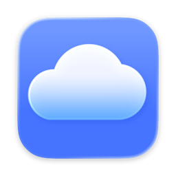
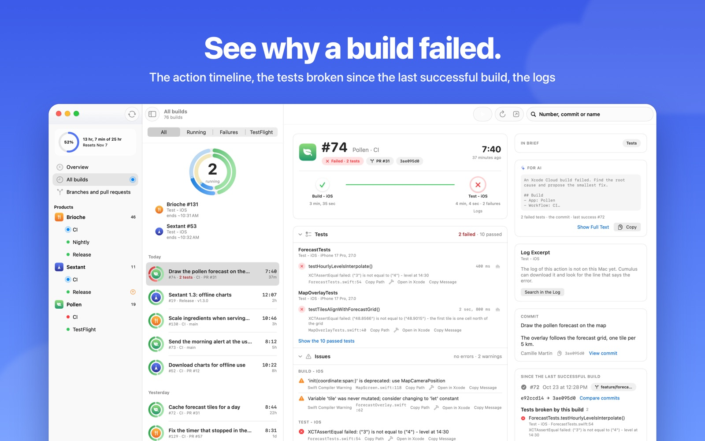
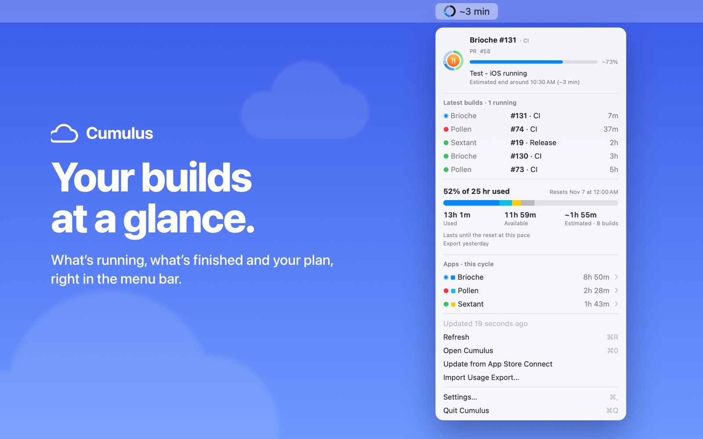
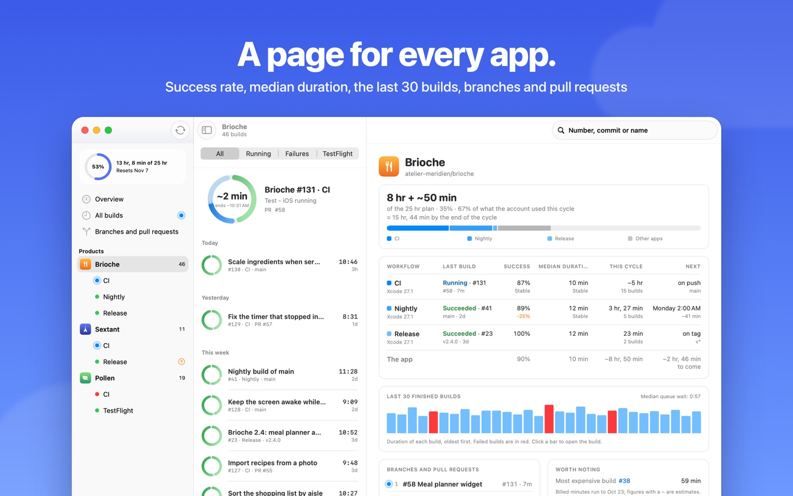

<p align="center">
  
</p>

<h1 align="center">Cumulus</h1>

<p align="center">
  Your Xcode Cloud builds and minutes, in the Mac menu bar.<br>
  <a href="https://apps.apple.com/app/id6821029129">Mac App Store</a> · <a href="https://cumulus.guik.io">Website</a>
</p>

Cumulus is a macOS menu bar app that watches Xcode Cloud for you: how much of your compute plan is gone, which builds are running, and why the last one failed.

It is free, has no server and no third-party dependency, and talks to nobody but Apple.



<table>
  <tr>
    <td></td>
    <td></td>
  </tr>
</table>

## Install

With [Homebrew](https://brew.sh):

```bash
brew install --cask guikbsx/tap/cumulus
```

This also puts the `cumulus` command on your `PATH`. `brew upgrade` brings the next versions.

You can also get Cumulus from the [Mac App Store](https://apps.apple.com/app/id6821029129), or download the archive of the [latest release](https://github.com/guikbsx/xcode-cloud-companion/releases/latest). Both builds are the same app: the one from GitHub is signed with Developer ID and notarized by Apple. Install only one of them.

## What it does

**In the menu bar**

- A gauge of the compute minutes used in the current billing cycle, against your plan.
- The build that is running right now, drawn as a ring of its actions, with an estimated end time.
- The five latest builds, and a submenu per app.

**In the window**

- An overview that opens on a headline (what is broken, what is slow, whether the plan will last) above a 35-day mosaic of every workflow.
- A build sheet: actions, compiler errors, failed tests, artifacts, logs, and the commit. Errors and tests open in Xcode at the right line when you point Cumulus at your local clone.
- "What broke": a failed build compared with the last successful one of the same workflow.
- An excerpt of the log around the line that carries the error.
- "Copy for an AI": the failed build as a Markdown prompt, ready to paste.
- A one-sentence summary of a failed build, written on your Mac by Apple Intelligence when it is available.
- Per workflow: trends, flaky and slow tests, the history of a single test, where the minutes go, and the build since which it got slower.
- Branches and pull requests, scheduled builds to come, outdated Xcode versions.
- TestFlight: the latest builds of an app, the path from commit to testers, giving a build to tester groups, expiring a build.
- Starting or re-running a build, pausing or editing a workflow.

**Around the app**

- Local notifications: a build finished, a build is stuck, the plan is at 75 % or 90 %, a workflow slowed down, a TestFlight build is about to expire. The same alerts can go to Slack, Discord or any webhook.
- Widgets, Siri and Shortcuts.
- Several App Store Connect accounts side by side.
- A command-line tool and an MCP server for coding agents (see below).
- English and French.

## About the numbers

Apple's API exposes neither the Xcode Cloud usage nor the quota. The minutes Cumulus shows are therefore an **estimate**, computed from the duration of each build's actions and test destinations. You enter your plan and its reset date yourself.

To get exact figures, import the usage export (CSV) from App Store Connect: billed minutes then replace the estimate for every build the export lists, and Cumulus uses them to calibrate its estimate of the builds that came after.

Cumulus always says when a figure is an estimate. It is never an official number from Apple.

## Requirements

- macOS 26 or later
- An App Store Connect API key (Issuer ID, Key ID and the `.p8` file) for a team that uses Xcode Cloud

A read-only key is enough to watch. Starting builds, editing workflows and TestFlight distribution need a key that is allowed to write, and each of those actions asks for confirmation first.

## Privacy

- The API key is stored in the macOS keychain, never in a file or in preferences.
- The app is sandboxed.
- Requests go to the App Store Connect API, to Apple's image servers for app icons, and to Apple's public system status page. A webhook receives alerts only if you set one up.
- No analytics, no account, no server of ours.
- The failure summary is generated on device.

The full policy is at [cumulus.guik.io/privacy](https://cumulus.guik.io/privacy/).

## For coding agents

`Cumulus.app` embeds a `cumulus` command and an MCP server. Both answer from the cache the app keeps, so they are fast, work offline and cost nothing of the API rate limit.

```
cumulus status
cumulus builds --failed --since 7d
cumulus build MyApp#42
cumulus usage --by-workflow
cumulus run "Release" --branch main
cumulus mcp
```

Output is JSON in a pipe and a table in a terminal. Install the command, the agent skill and the MCP server from **Settings › Agents**, which has a checklist for Claude Code, Codex, Xcode and Claude Desktop.

The skill in [`xcode-cloud-companion/AgentSkill/cumulus`](xcode-cloud-companion/AgentSkill/cumulus) documents every command, tool and error code.

## Building from source

You need the latest public release of Xcode. There is nothing to install: the project has no dependency.

```bash
xcodebuild build -scheme Cumulus -project xcode-cloud-companion.xcodeproj -destination 'platform=macOS'
```

```bash
xcodebuild test -scheme Cumulus -project xcode-cloud-companion.xcodeproj -destination 'platform=macOS'
```

To run your own build, set your development team on the three targets, and replace the app group identifier (it starts with the team ID) in the three files of `Config/*.entitlements` and in `xcode-cloud-companion/Sync/SharedContainer.swift`. The app, the `cumulus` command and the widgets share their data through that group.

Tests never call the network: they run on JSON fixtures, and the app does not sync when it is launched as a test host.

## How the code is laid out

| Folder | What lives there |
|---|---|
| `xcode-cloud-companion/` | The app: AppKit life cycle, a native `NSMenu` with hosted SwiftUI rows, the main window, Settings |
| `xcode-cloud-companion/AppStoreConnect/` | JWT signing, requests, JSON:API decoding |
| `xcode-cloud-companion/Sync/` | Synchronisation, snapshot cache, request budget |
| `xcode-cloud-companion/Usage/` | Usage estimate, CSV import, calibration |
| `CLI/` | The `cumulus` command, its MCP server, and the files it shares with the app |
| `Widgets/` | The WidgetKit extension |
| `xcode-cloud-companionTests/` | Swift Testing suites and fixtures |

The code is Swift 6 with strict concurrency and `MainActor` isolation by default. [`AGENTS.md`](AGENTS.md) (in French) is the detailed guide to the architecture and to the pitfalls met along the way.

## Contributing

Issues and pull requests are welcome. Before opening a pull request, please make sure the project builds without warnings and the tests pass.

## License

The code is released under the [MIT License](LICENSE).

The name "Cumulus" and the app icon are not covered by that license: please give a fork its own name and icon.

Cumulus is an independent project. It is not affiliated with Apple. Xcode Cloud, TestFlight and App Store Connect are trademarks of Apple Inc.
